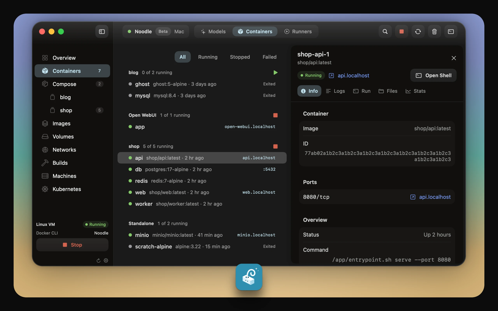

# Noodle

Docker-compatible containers and local AI models on Apple silicon, in one small native Mac app.

**Beta.** This is the first public release. It has run on one Mac so far, so expect rough edges and please report them.



Noodle serves the Docker Engine API from a Swift daemon, runs containers in one Linux VM through Virtualization.framework, and runs local models through an OpenAI-compatible endpoint. Your `docker` commands keep working. The app sleeps when nothing is running.

No telemetry and no account. Noodle sends no usage data and no crash reports. It talks to the services you use (image registries, Hugging Face, GitHub) and checks getnoodle.dev for a signed update.

## Install

```sh
brew install --cask ansumanshah/tap/noodle
```

Homebrew 7 asks you to trust a third-party tap first. If it refuses, run `brew trust ansumanshah/tap` and repeat the install.

Or download `Noodle-26.11.8.dmg` from [GitHub Releases](https://github.com/ansumanshah/noodle/releases), open it and drag Noodle to Applications.

## Quickstart

```sh
noodle setup
docker run --rm alpine echo hello
noodle model run qwen3.5-4b
```

`noodle setup` links the `docker` and `kubectl` CLIs (downloading them if missing), adds the `noodle` Docker context and starts the engine. Setup makes Noodle your Docker context when no other engine is running; otherwise add `--context noodle` or run `noodle setup --use`. `noodle setup --no-use` never switches it, and `noodle setup --tools` prefetches the plugins that otherwise download on first use. The first `noodle model run qwen3.5-4b` downloads Qwen 3.5 4B (3.06 GB, 4-bit MLX) and chats in the terminal.

## Why Noodle

- **Fast starts.** `docker run --rm alpine true` through the CLI took a median of 15.0 ms on Noodle, against 48.1 ms on Kiri 0.2.2, 130.3 ms on Docker Desktop 29.9.3 and 171.6 ms on OrbStack (Docker 29.8.2). Same Mac mini M4, 4 vCPUs and 2 GiB for every engine, 30 runs after 5 warm-ups.
- **Small when idle.** The daemon's physical footprint was 8.6 MB after the VM went to sleep. In the same run Kiri's daemon stayed at 15 MB with its 263 MB VM helper still up, and Docker Desktop used about 1.4 GB.
- **One engine for containers and models.** Compose `models:` and `docker model` work on the same socket.
- **Models stay on the Mac.** Inference runs on the chip. Chats go nowhere, and the endpoint listens on `127.0.0.1` with a required key.
- **Plain Docker.** There is no new command to learn. `compose`, `buildx`, `build` and Kubernetes go through the `docker` CLI.

Where Noodle loses: `docker build` failed in that benchmark run because the bench build pointed at a BuildKit download that did not exist. Cold image pulls were 2.8x slower than Kiri's. On local models, Ollama 0.40.16 decoded Qwen3 0.6B about 1.3x faster than Noodle on a Mac mini M4, and used less memory. First words on a long prompt came in at 312 ms against 328 ms. These runs shared the Mac with other desktop apps and background work, so small gaps are noise.

Against Kiri's own published numbers, Noodle misses three of its targets. The CLI run took 15.0 ms against Kiri's published 14.2 ms, `--network none` through the API took 1.75 ms against 1.26 ms, and a run after wake from sleep took 452.9 ms against 150 ms. It beats the bridge API run (1.99 ms against 2.55 ms). In a separate run at 2 vCPUs and 8 GiB, the idle daemon used 6.5 to 6.7 MB after the full bench, under Kiri's 9.0 MB. Guest agent memory has not been measured yet.

## What's inside

- **Noodle Containers** is the Docker-compatible runtime: containers, images, volumes, IPv6 networks, Compose, builds, amd64 images through Rosetta, `*.localhost` names with local HTTPS, single-node Kubernetes and Linux machines.
- **Noodle Models** runs GGUF and MLX models through one pinned [mlx-serve](https://github.com/ddalcu/mlx-serve) process. It has a chat page that takes images, video and audio, a Create tab for images, speech and video, a Control-Option-Space shortcut and Shortcuts actions, an OpenAI-compatible endpoint with embeddings and speech (`noodle model endpoint` prints the URL and key), optional access from other devices on your network (`noodle model network on`), a model folder you can move to an external drive, a keep-loaded setting and `docker model`. See the [local model guide](docs/architecture/models.md).
- **Noodle Runners** runs GitHub Actions self-hosted runners on your Mac, single-use, in Linux containers or (opt-in, trusted repos only) directly on macOS.

### Local names, no ports

Containers with a web port answer at `http://<name>.localhost` and `https://<name>.noodle.local`, Compose services too. A dev server already running on your Mac gets a name with one command:

```sh
noodle names add api.myapp 3000    # https://api.myapp.localhost
noodle names remove api.myapp
```

WebSockets and hot reload pass through, and names survive a restart. Run `noodle names trust` once so browsers accept HTTPS. No root, no `/etc/hosts` edit, and the listener accepts only connections from this Mac. If another app holds ports 80 or 443, Noodle uses 10080 and 10443 and says so. See the [networking docs](https://getnoodle.dev/docs/containers/networking/).

## What Noodle touches on your Mac

Noodle needs no root and edits no system files: no `/etc/resolver`, no hosts file. The app does not start the daemon on launch.

- **`~/.noodle`** holds VM disks, image blobs, logs, the Docker socket (`run/docker.sock`, mode 0600) and downloaded tools. `NOODLE_HOME` moves it.
- **LaunchAgent `~/Library/LaunchAgents/dev.getnoodle.noodled.plist`**, written by setup, lets `noodle start` run the daemon. `RunAtLoad` is off, so nothing starts at login.
- **Docker context `noodle`**, selected by setup when no other engine is running (the current context is `default` and nothing answers on `/var/run/docker.sock`). Otherwise your context stays; `--use` forces the switch and `--no-use` never does. `noodle uninstall` restores `default`.
- **Files in your home:** `~/.local/bin/noodle`, a `docker` link there if none exists, Compose and Buildx links in `~/.docker/cli-plugins`, and a PATH block in your shell profile only with `noodle setup --path`.
- **Downloads** go to `~/.noodle/tools` and must match a pinned SHA-256. Setup fetches a missing Docker CLI and kubectl. Compose, Buildx, BuildKit and the model runner download on first use.
- **Local names:** containers with a web port get `*.localhost` names on loopback port 80, or another port if 80 is taken. `NOODLE_LOCAL_NAMES=0` turns them off.
- **Keychain:** nothing by default. `noodle names trust` adds a local HTTPS authority and macOS asks for your password. `noodle names untrust` removes it.
- **Folders:** single-file bind mounts need `noodle share add FOLDER`.
- **Network:** containers reach the internet through the VM's NAT. Published ports bind `0.0.0.0` unless you give a host IP. See [security](docs/security.md).

### Uninstall

| Command | Removes | Stays |
| --- | --- | --- |
| `noodle uninstall` | LaunchAgent, Docker context, setup links, PATH block, the `noodle` copy in `~/.local/bin`, the socket | `~/.noodle` |
| `noodle uninstall --delete-data --yes` | All of the above and everything in `~/.noodle` | Files outside it, keychain trust |
| `noodle tools remove` | Downloaded Docker tools and the plugin links Noodle owns | Container data |

The app has the same under **Noodle > Uninstall Noodle…**. Run `noodle names untrust` first if you ran `noodle names trust`, and stop Linux machines before deleting data. Moving `Noodle.app` to the Trash alone leaves the LaunchAgent and `~/.noodle` in place; `~/.local/bin/noodle uninstall` still works afterward.

## Requirements

An Apple silicon Mac on macOS 26 or later. Intel Macs, Linux and Windows hosts are not supported.

## Status and limits

Noodle is v26.11.8, an early release.

- The device policy of the privileged-container VM has had no independent security review. Do not use it as a sandbox for untrusted code.
- The last full Docker CLI run on macOS 27.2 had 599 cases: 591 passed, 3 failed and 5 were skipped. The 3 failures have since been fixed and pass when run alone; the full run was not repeated. The skips are opt-in checks (a real public tunnel, Podman import, model downloads). macOS 26, the stated minimum, has not been run yet.
- Builds are not reproducible. Source availability does not verify the DMG you download.
- Recovery after power loss is untested. Killing the daemon during a native build corrupted a disposable disk once.
- `docker model` and Compose `models:` are implemented, and their end-to-end cases are still pending.

Open work is tracked in [GitHub issues](https://github.com/ansumanshah/noodle/issues).

## Build from source

Install Xcode with Swift 6.2 or later, `mise` and `just`, then `mise trust && mise install`.

```sh
just build     # noodled, noodle, noodle-machine (release)
just kernel    # guest kernel, about 10 minutes the first time
just tools     # pinned docker, compose and buildx
just run       # daemon in the foreground, home in build/dev-home
just app       # ad-hoc signed build/Noodle.app
```

`just kernel` needs Apple's `container` CLI with its service running. Set `NOODLE_KERNEL` to reuse an arm64 Linux kernel you already have. In a second terminal after `just run`:

```sh
build/tools/docker --host "unix://$PWD/build/dev-home/run/docker.sock" run --rm alpine:3.22 echo hello
```

Checks: `just test-unit` (Swift, Zig, ShellCheck, no VM), `just test-app`, `just e2e` (real Docker CLI against an isolated daemon, needs an Apple silicon host). The website is a Next.js and Fumadocs site in [website/](website/README.md).

## Contributing

Read [CONTRIBUTING.md](CONTRIBUTING.md). Report vulnerabilities through [SECURITY.md](SECURITY.md), not public issues. Changes to the release history are in [CHANGELOG.md](CHANGELOG.md).

## License

Apache-2.0. See [LICENSE](LICENSE). Third-party components keep their own licences; see [NOTICE](NOTICE).
